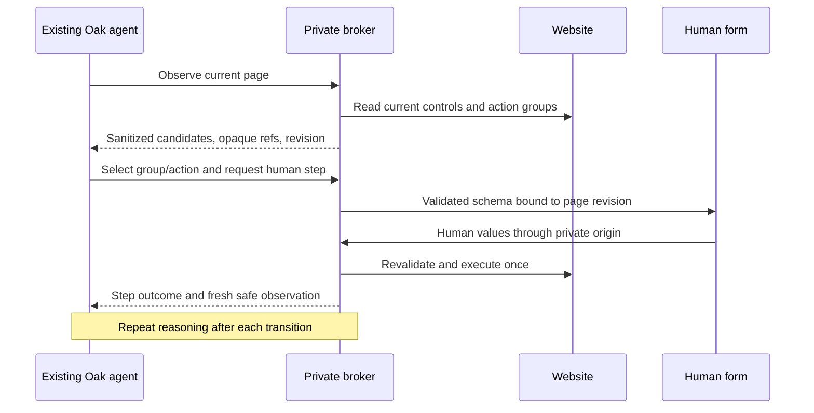

# Website forms: owner failures and agent architecture

Research and diagnosis: 2026-10-11. Baseline: `e9f5e87`. **Owner acceptance
failed for Google and TikTok.** This report distinguishes live observations,
controlled reproductions, inspected upstream implementations and a proposed
integration. It does not establish successful account login.

The central implementation error is architectural: Oak advertised an agentic
solution, but the native agent waits for one terminal login result. Fixed
JavaScript inspects the page while the private UI polls it. The model does not
receive the next page, choose a login method or plan the next human form.
Adding more provider names or replacing the renderer cannot supply that loop.

## What actually failed

The Hub owner reports describe a TikTok chooser dead end, a Google identifier
submission that terminates, and a later empty generic Google form. Read-only
status metadata confirms these were separate attempts, with cleanup confirmed.
No previous private DOM, credentials, cookies, profile contents or raw logs were
read. New public probes used isolated anonymous browsers, initial GET only,
and closed their contexts.

| Finding at baseline | Evidence | Consequence |
| --- | --- | --- |
| Generic Google combines unrelated forms | Both the root URL and ServiceLogin redirect normally to the identifier page, HTTP 200. The collector includes the POST email form and a separate GET language selector; its global `groups <= 1` rule fails. | Returns `unsupported_challenge`, removes all fields. No CAPTCHA was observed. The shortcut adapter shows email because it uses different collection rules. |
| TikTok chooser is absent from supported actions | Public login page, HTTP 200: phone/email choice is `div role=link tabindex=0`; the collector includes buttons/role=button only. | The user receives no usable login choice. A chooser is a normal intermediate step, not evidence of a challenge. |
| TikTok resources are blocked | Exact-origin policy aborted 17 external scripts, 3 stylesheets and 15 fonts on the public page. | Recognizing a clickable element alone cannot establish its JavaScript handler is functional. Main-navigation `blocked=false` does not mean dependencies loaded. |
| Normal full-document navigation can terminate the lease | Across 48 intercepted synthetic POST transitions, all submissions were accepted; immediate verification/snapshot reads encountered execution-context destruction in 40 trials. | The adapter wraps a transient read error; broker `bounded()` closes the browser as `failed`; UI treats the resulting error as terminal. |
| Harmless page drift also terminates | Hidden-CSRF change or replaced controls is rejected before click in controlled fixtures. | Re-observation is appropriate when no action was dispatched; treating all stale forms as terminal prevents recovery. |
| Unsupported layout is mislabeled | Unknown forms default to `unsupported_challenge`; UI supplies a fixed verification message. | A message saying the site requests verification is not evidence that it does. |

The navigation race is a **proven failure mechanism matching the post-email
symptom**. Its occurrence in that historical private attempt remains unknown:
the deployed database retained no sanitized reason/action-commit diagnostic.
Do not retrospectively label that attempt CAPTCHA, provider rejection, or a
confirmed navigation exception.

The baseline full suite passed **345 tests, zero skipped**, including enabled
browser fixtures, in 91.633 seconds. Earlier first-page probes never submitted
an identifier and used the Google shortcut rather than the owner's generic
Google path. Those were coverage gaps, not successful end-to-end acceptance.

The concrete path is:

```text
native tool → InputRequests._ask waits for terminal future
            → Mini App opens private broker form
            → login.js polls /api/form every 1.5 seconds
            → fixed WebsiteForms / WebsiteBrowser snapshot
human submit → private broker fill/click → fixed snapshot again
terminal state → original native tool finally returns
```

Source boundaries: [requests](../oak/requests.py), [gateway bridge](../oak/login.py),
[broker](../oak/login_broker.py), [generic collector](../oak/website_forms.py),
[provider adapter](../oak/signin_providers.py), [private UI](../oak/login_web/login.js).

## Existing implementations and what they really provide

Official documentation, package metadata and pinned source were inspected.
No candidate framework was installed into production. The
[detailed upstream review](browser-agent-upstream-review.md) records 51 pinned
source-file references, mechanisms and limitations for Browser Use, Stagehand
and Skyvern. Versions are reviewed snapshots, not claims of compatibility.

| Option and reviewed version | Relevant existing mechanism | Fit for Oak |
| --- | --- | --- |
| Browser Use 0.13.11, MIT | Repeated browser-state → model → action loop, DOM/AX references, page-specific actions, pause/resume, domain-scoped secret aliases. | Strong reference for the missing loop. Its full Agent expects its own model interface; lower DOM/direct tools can be driven by Oak's existing model. Text redaction does not cover images. |
| Stagehand SDK 4.2.1, MIT | Current v4 supplies snapshots/actions and an experimental local Codex facade; v4 removed the former autonomous `agent()` API. | A harness candidate preserving existing Codex login. Primitive actions avoid another model; natural-language observe/act/extract do inference. Broad JavaScript execution must not reach the private browser. |
| Playwright MCP 0.0.83, Apache-2.0 | Accessibility snapshots and referenced click/type actions; caller supplies the reasoning loop. | Close to Oak's existing Playwright foundation. Latest inspected package requires Playwright `1.64.0-alpha-1790635538000`, whereas Oak pins 1.63.0; evaluate a compatible pin rather than installing latest blindly. |
| agent-browser 0.39.0, Apache-2.0 | Native browser command harness with snapshot references and deterministic actions; outer agent chooses each next step. | Another harness candidate without a second planner. Node package requires >=24. Controls and policies are opt-in; full CLI access is too broad for the secret context. |
| Skyvern 1.0.55, AGPL-3.0 | Full step loop, credential/OTP references, one-time human pause/resume, stale snapshot detection. | Useful concrete lifecycle patterns. Whole-stack adoption adds substantial service/database/model infrastructure. Secret/artifact masking depends on configuration. |
| AG-UI core 1.0.2, MIT | Tool lifecycle, user-mediated result, agent continuation events. | Carries the pause/resume conversation. It does not inspect a website. Oak currently implements a subset rather than using this SDK. |
| A2UI web-core 0.13.0, Apache-2.0 | Declarative component processing, state/binding and rendering integration. | Renders a validated schema after a planner chooses it. Existing catalogue mapping work remains separate from browser reasoning. |

Playwright MCP describes its accessibility-based tool model and explicitly
states it is not a security boundary. Its secret substitution is a convenience,
and its origin options do not contain redirects. Therefore putting its entire
tool surface in front of Oak's credential browser would remove guarantees the
current broker enforces. Restrict the adapter, not just the prompt.
[Official README](https://github.com/microsoft/playwright-mcp),
[pinned package](https://github.com/microsoft/playwright-mcp/blob/f183dad4a52965583e3cc1d59b88cdc279e2e57d/package.json).

agent-browser references survive same-document updates only while their DOM
nodes survive; replacement/navigation invalidates them. Its docs require new
snapshots after interactions. Its security controls are optional and an origin
filter is not an OS firewall. A built-in credential vault is not the same
integration as collecting a fresh private human step in Telegram.
[Snapshot contract](https://agent-browser.dev/snapshots),
[security contract](https://agent-browser.dev/security),
[exact package metadata](https://registry.npmjs.org/agent-browser/0.39.0).

AG-UI's tool result lets an agent continue after a user response; failed tools
must be distinguished from successful results. A2UI processors manage the
resulting UI. Neither independently selects the login form or interprets the
next website state. Migrating Oak to React or an upstream renderer is therefore
not a prerequisite for fixing the missing planner.
[AG-UI tool lifecycle](https://docs.ag-ui.com/concepts/tools),
[A2UI renderer guide](https://a2ui.org/guides/renderer-development/).

MCP elicitation provides a useful separate-channel pattern: ordinary form mode
must not request passwords or access tokens; sensitive interactions use URL
mode. Accepting the invitation does not establish authentication. URL completion
requires a correlated server result, with the interaction bound to the user.
Oak's private iframe/ticket protocol is its own protocol; it does **not** already
implement MCP URL elicitation, and a future adapter must check the complete
client-isolation and URL requirements.
[MCP 2025-11-25 elicitation](https://modelcontextprotocol.io/specification/2025-11-25/client/elicitation).

## Native-agent target and the optional Jev implementation

The owner subsequently requested a ready component library and identified the
existing trading API. Hub task224 located **Jev `typesafe/jev-1.13` through
OpenRouter**, on a different trading host, not the Oak VM. Jev uses the Decisions
endpoint and chooses among typed alternatives; it does not generate chat text
or arbitrary component code. Its dated response snapshot is
`typesafe/jev-1.13-20260917`.
[Official Jev tutorial](https://openrouter.ai/docs/guides/community/jev-tutorial).

The [component catalog and optional helper](website-component-library.md)
implement a local browser→structural observation→Jev group choice→private form
loop, followed by fresh observation after human input. This owner-requested
helper is distinct from the native-agent tool-continuation design below. It
does not replace the subscription runtime, execute clicks, authorize new sites,
or expand network policy. API evaluation task225 is held by the trading agent's
direct-owner-confirmation requirement; no live model test or latency claim has
been established. Follow-up task226 requests private provisioning; report5155
confirms the transfer mechanism and the remote agent's direct-owner instruction
are still missing. The credential is not provisioned on Oak.

Keep Oak's subscription-backed native agent, the private broker as browser and
credential owner, and existing widgets for the human form. The alternative
same-native-agent design below would require no additional paid provider.
Reuse maintained browser primitives and evaluate a restricted
snapshot/action harness. Stagehand's local facade and Browser Use's DOM layer
are substantive alternatives; Playwright MCP and agent-browser are narrower
comparators. No measured local comparison yet establishes a winner, so this
report does not replace the browser stack based on documentation alone.

The required loop is:



This changes the native request lifecycle, not merely the browser selectors:

1. **Separate a website lease from a pending human step.** Preserve owner,
   chat, thread, turn and runtime binding. Do not let `_ask` block the only
   planner until the entire login finishes. End-of-turn cleanup remains.
2. **Expose bounded observations before authentication.** Include candidate
   groups, visible labels/types/choices/actions, origin/frame identity and
   opaque references. Exclude field values, account details, raw HTML, cookies,
   arbitrary selectors, console/network dumps and screenshots containing input.
   Treat website text as untrusted data, never instructions.
3. **Let the same native agent select the next step.** The model can select
   phone/email versus QR, a form group or an alternate method. It cannot invent
   credential fields or executable HTML. Broker validation must ground every
   proposed field/action in the current observation and allowed destination.
4. **Send human values directly to the broker.** Each form uses a one-use
   step/revision capability; secrets never travel in model tool arguments or
   ordinary A2UI/AG-UI payloads. The model receives only outcome plus a fresh
   sanitized observation. Browser context remains alive across steps.
5. **Resume reasoning after each action.** Email → password → wrong password
   → method choice → OTP → completion must be repeated observation and
   decisions, not a hardcoded sequence of provider stage names. QR/push/passkey
   needs an appropriate human interaction, not an invented text field.
6. **Make execution uncertainty explicit.** A stale observation before action
   requests refresh; a committed submit proceeds to read-only observation;
   uncertain dispatch is never automatically replayed. Actual security-binding
   violations close the lease. Authentication still requires positive evidence;
   owner confirmation is a separate outcome.

Before input begins, observation labels are generally public website data.
After input, even labels/errors may echo human values. Known-value replacement
alone cannot guarantee arbitrary transformed or image echoes are absent. The
adapter needs a bounded metadata channel with explicit filtering and tests;
raw upstream snapshots must not simply be returned to the model.

Resource policy is another independent prerequisite. Split main/frame
navigation and credential-recipient authorization from subresource loading.
Loading every third-party request is not a correction for blocking every CDN.
Use reviewed executable/resource origins, public-address resolution/pinning,
redirect checks and host egress containment; preserve destination confirmation
for a new credential recipient. Public DNS alone does not make JavaScript safe:
CDN scripts execute with the page's access. The collector fix alone does not
resolve this TikTok dependency limitation. The subsequent two-host static fetcher
and its limits are recorded in the
[scoped resource policy](website-resource-policy-proposal.md).

Playwright's own documentation distinguishes navigation commit, document
loading and later hydration. Seeing an enabled control is not proof its event
handler has loaded. Use bounded state/actionability observation; a fixed sleep
or blanket `networkidle` wait is not a general multistep contract.
[Navigation and hydration](https://playwright.dev/python/docs/navigations),
[actionability](https://playwright.dev/python/docs/actionability).

## Acceptance required before another success claim

| Check | Required evidence |
| --- | --- |
| Same user entry path | Natural-language native tool → Mini App attachment → broker → synthetic identifier submit → next human step. A direct first-page adapter GET does not substitute. |
| Actual model planning | Exercise the selected design on successive observations: the proposed native continuation, or the owner-requested Jev helper. Record real inference separately from mocked responses, including decision accuracy and end-to-end latency. |
| Previously unknown layout | Random IDs, reordered groups, footer language form, role=link chooser, same-URL replacement and delayed controls; no Google/TikTok-specific selector patch. |
| Recovery | Pre-submit DOM drift, navigation-in-progress, validation failure and wrong OTP leave an accurate next action; accepted/uncertain writes are never replayed. |
| Private values | Synthetic canaries absent from ordinary DB/events/model/tool outputs, parent messages and artifacts, including echoed text/image paths. |
| Human controls | Back, alternate method, cancel, expiry and reopen; usable mobile focus/keyboard; an unsupported layout is not called CAPTCHA. |
| Real providers | Only after the controlled path passes: owner-entered Google, Instagram and TikTok checks. Record each actual result separately; no blanket all-site guarantee. |

The narrow local corrections accompanying this investigation address reproduced
collection, classification and transition handling. They do not implement the
proposed native planning loop, authorize broader CDN loading, prove a mobile
Telegram flow, or establish real provider authentication. Production rollout
and owner acceptance are separate records.

### Focused correction evidence

Focused correction commit `5f7aa0f` passed **371 tests, zero skipped, in 74.427 seconds**
with `OAK_PROVIDER_BROWSER_TESTS=1`. This includes the new
[native-to-browser path test](../tests/test_website_form_path.py): real gateway
bridge and broker HTTP, intercepted Chromium POST, next password form, exactly
one submission, cancellation cleanup, and canaries absent from ordinary
state/events/control/model output. Native model inference and Telegram WebView
are not part of this controlled test.

Fresh anonymous public GET-only probes using corrected local code showed:

- Generic Google ServiceLogin: one field and three actions, stable at initial
  observation and two seconds. This corrects the unrelated-language-form bug.
- Generic TikTok login: zero fields and seven chooser actions, stable at both
  observations. No chooser was clicked; blocked CDN dependencies and actual
  login remain unresolved.

The separate component/helper integration subsequently passed **431 tests,
zero skipped, in 92.077 seconds**. Its native-RPC → broker → Chromium fixture
uses the generic Google ServiceLogin URL, selects email over an unrelated search
form, submits once, selects the next password group, and keeps a synthetic
identifier out of mocked Decisions payloads and ordinary state. Same-revision
polling does not call the model again. This is protocol/controlled-browser
evidence; the API answer is mocked. See the
[component contract and activation blockers](website-component-library.md).

No credentials were entered in those public probes; both contexts were closed.
The focused patch adds separate `unsupported_layout` and genuine detected
challenge states, read-only navigation settling, recoverable pre-action stale
responses and terminal uncertain-dispatch handling. It is a correction to the
existing deterministic path, not the proposed native planner.


## Owner-supplied Open Intelligent UI reference — 2026-10-12

The quoted announcement is [CopilotKit Open Intelligent UI](https://www.copilotkit.ai/blog/introducing-open-intelligent-ui),
released October 9. Inspected source commit
`f6e4388b26a64b9a0714943b08a1ce622b924eec` from
[the repository](https://github.com/CopilotKit/OpenIntelligentUI).
No installer or package script was executed and no production frontend changed.

The reusable parts are component registration, streamed rendering, shared agent
state, and human-interaction continuation through AG-UI. Its
[`visualization_router.py`](https://github.com/CopilotKit/OpenIntelligentUI/blob/f6e4388b26a64b9a0714943b08a1ce622b924eec/apps/agent/src/visualization_router.py)
makes a typed Jev Choice for the presentation format and retains that decision
across tool continuations. A separate answer model generates the actual content
or custom HTML/CSS/JavaScript. Its standalone MCP server exposes document
assembly, skills and prompt resources; it is not a website-browser executor.
The supplied
[`form.py`](https://github.com/CopilotKit/OpenIntelligentUI/blob/f6e4388b26a64b9a0714943b08a1ce622b924eec/apps/agent/src/form.py)
returns a fixed, explicitly non-functional example login schema. It neither
observes an external page nor authenticates an account.

For Oak, the matching UI pattern is a component catalogue with an opaque private
form surface and status/events. The example human-in-the-loop hook normally
returns its response to the agent; account secrets must continue travelling only
inside Oak's private broker channel. Replacing the renderer alone does not add
browser navigation or establish a latency improvement. The immediate experiment
therefore compares the existing native GPT step loop with a delegated Jev step
planner over the same installed browser and private renderer. Timing will separate
model decisions, browser startup/load, broker transport and first visible form.
The reference is useful for the UI integration layer, not evidence that Jev can
execute browser tasks without an application-owned tool loop.
