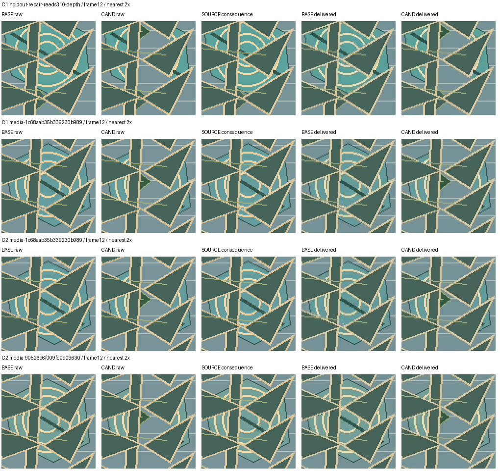

# Cycle 3 — diagnosing and testing source-preserving media procedures

**No quality gain: the new candidate is rejected and the original baseline stays
active.** On six fresh tasks, joint success fell from 5/6 to 2/6. On four revealed
regressions it fell from 3/4 to 2/4. The model remained `gpt-6.1-sol / low`.

| Cycle-3 comparison | Baseline | Candidate | Candidate wins / losses / ties |
| --- | --- | --- | --- |
| Six fresh tasks | 5/6 | 2/6 | 1 / 4 / 1 |
| Four regression tasks | 3/4 | 2/4 | 1 / 2 / 1 |

All twenty independent executions delivered and passed the same-SHA native
visual review. Twelve passed the separate mechanical content checks: eight
baseline and four candidate results. There were no unknown, incomplete or
unverified arms. The actual gate rejected with `no_strict_fresh_holdout_gain`
and `regression_loss`. No candidate activation or learned native follow-up ran.
The finite experiment completed after its single predeclared cycle; all
observed losses are retained.

The first two cycles produced real source-detail regressions. This experiment
continues their existing scoped pipeline state, uses a previously revealed
failure as DEV and tests the next upstream-generated candidate on six new
holdouts. The model remains `gpt-6.1-sol`, low effort, through the existing
ChatGPT subscription. The [predeclared protocol](protocol.md) records the scope,
finite budgets, fresh-input policy and unchanged admission criteria.

## What caused the previous losses

All four candidate losses failed the same two source-pattern checks: moving
`actor_far` and `actor_near`. Format, stationary artwork, layer-depth checks and
the native visual review passed. A detailed examination found actual excess
occlusion. The renderer enlarged cream-outline pixels, flood-filled the enclosed
regions and shrank the mask. That operation closed genuine open gaps between
leaves as well as internal line breaks. Pasting the stationary mural through
this mask erased actor details that should remain visible.

The defect exists in original PNG render frames before encoding and persists
in the exact delivered MP4 bytes. It is not explained by codec loss, frame-time
convention or the older unrelated marker/scorer ambiguity. All examined passing
and failing executions use the valid public interpolation `u=n/35`.

| Revealed case | Excess opaque pixels per veil beyond the allowed boundary | Actor source pixels lost in diagnostic frame 12 |
| --- | --- | --- |
| Cycle 1, repair310 regression | 1,588 | 986 |
| Cycle 1, repair `media-1c68…` | 1,690 | 460 |
| Cycle 2, repair `media-1c68…` regression | 1,702 | 460 |
| Cycle 2, creation `media-90526…` | 1,690 | 454 |

The matched passing baseline masks had zero excess or missing pixels beyond
the disclosed boundary neighborhood. On the diagnosed source pixels, the raw
baseline restores the original actor pattern exactly, while the candidate
replaces it with stationary mural pixels. These are postcompletion diagnostics
on already revealed cases, not newly scored holdouts or changes to grading.



The figure uses a fixed crossing frame and nearest-neighbor 2× crops. Columns
show baseline raw, candidate raw, source consequence, baseline delivered and
candidate delivered. Full source/artifact/raw-frame SHAs, pixel examples and
code excerpts are in [the diagnostic evidence](regression-diagnosis.json).
[The reproduction script](reproduce-regression-diagnosis.py) takes explicit
`--root` and `--output` paths; old workspaces and delivered bytes are read only.

This identifies the rendering mechanism in those executions. It does not prove
that the procedure text itself forced the mistake: model behavior is stochastic
and earlier probes did not measure that causal effect. The visual reviewer
missed the local defect, and the optimizer had no approved concrete correction
about it. Both earlier DEV contexts had no user feedback; the second only added
prior role responses, whose reflections correctly returned `NO_ENTRY`.

## What changes in this cycle

The exposed cycle-2 creation failure is explicitly promoted to DEV. Its approved
[case](development-case.json) and [factual feedback](development-feedback.json)
describe the visible lost details and cite the actual failed rendering code and
artifact SHA. They contain no independent numerical grades, thresholds, hidden
masks, new holdout inputs or hand-authored candidate procedure. The current
original baseline stays unchanged; both previous rejected procedures stay
rejected. Genuine Harness² owns all proposal, probing, composition, selection
and reflection.

Search width increases from one to two. Genuine upstream `k=2` uses eight DEV
producer executions and eight improvement-role calls, including a real selector
between two composed finals. Repeats on this one DEV case are not independent
tasks. The existing pipeline's `schedule --config` option now supports a complete
trusted configuration so task counts and search budgets can be sealed without
a new experiment orchestrator.

Four exposed regression cases and six fresh holdouts add twenty independent arm
executions. The new holdouts contain three creations and three repairs and were
generated once, with no selection by outcomes. Independent review begins only
after candidate freeze. The source constructors, property checks, thresholds,
visual reviewer, isolation, permissions and per-attempt limits remain unchanged.
Only declared task counts change in the admission policy; see the
[protocol comparison](pre-native-protocol-check.json). Source pin mapping is
retained in [source-version.json](source-version.json).

Admission still requires strictly more fresh-holdout joint successes, no lost
baseline successes in regression, valid source/condition bindings, complete
deliveries and separate visual/mechanical checks on the same delivered SHA.
Six fresh examples support only a narrow measured comparison in this synthetic
distribution. They do not establish broad media quality or live provider access.

## Frozen search and evidence available to the selector

The completed native search used eight DEV producers and eight improvement-role
calls. The selected procedure is preserved verbatim in
[candidate-procedure.md](candidate-procedure.md); its immutable version and
freeze binding are in [candidate-freeze.json](candidate-freeze.json). Both
composed finals had byte-identical procedure text. The selector compared their
executions, so this is not evidence of choosing between different instructions.
Reflection again returned `confounded / NO_ENTRY`: the upstream experience
Library remained empty. Prior role responses and the approved factual feedback
were available through the separate attempt-history channel.

[An independent role-context audit](role-context-independent-qa.json) passed
60/60 checks. All eight role contexts contained the exact approved DEV feedback
and recorded a request to read its path. The audit does not record read offsets
or returned lengths, and cannot establish that the model consumed or understood
every character. No new independent task, grader or result entered those contexts.

The selector received five source images but **zero rendered output images**.
The pinned upstream selection API asks for `deliverable_assets`; Oak's adapter
only implemented `deliverable_images`, used by editing contexts. This interface
gap left selection with textual delivery and visual-review observations. Its
own response correctly said that it could not inspect the resulting animations
or verify continuous motion. Four earlier native losses passed visual review
while failing source preservation, so those textual pass verdicts are weak
selection evidence. This is a concrete adapter defect; it does not establish
that adding images would have selected a better result or improved this run.

The cycle uses the sealed implementation throughout independent evaluation.
Any subsequent adapter repair is a separately identified change, not part of
this candidate's measured quality result.

## Regression results in cycle 3

The four previously revealed regression tasks produced 3/4 joint successes for
the original baseline and 2/4 for the frozen candidate: one candidate win, two
candidate losses and one passing tie. Each candidate loss passed native visual
review and failed independent content checks. This already violates the sealed
zero-regression admission criterion, irrespective of the fresh-holdout rate.

[The cycle-3 trace diagnosis](cycle3-regression-trace-diagnosis.json) distinguishes
the two losses. Creation `media-3074…` again bridges real negative spaces and
loses actor detail. Repair `media-201b…` instead leaves hollow regions inside
solid stems: actor patterns pass, but both foreground depth checks fail. A
baseline failure on `reeds310` uses the same gap-bridging mechanism; the candidate
passes that pair. The problem remains unstable rendering behavior, rather than
evidence that one procedure reliably determines the outcome.

That diagnosis sampled existing source/mask PNGs and traced their last writers
and readers in the final renderer. It binds source, mask, code and delivered-file
hashes but does not claim a read-time PNG commitment or a newly decoded causal
effect size. It made no new model, grader or codec calls and did not open fresh
holdout examples. No findings were sent back to the frozen optimizer.


## Post-cycle adapter repair and verification

After every native call finished, all fifteen sealed implementation files were
verified unchanged in [sealed-run-source-qa.json](sealed-run-source-qa.json).
Only then was the selector interface repaired. The adapter now implements the
actual upstream `deliverable_assets` hook. It reuses artifact-bound inspection
images or derives bounded rendered samples with the existing trusted video
inspector when a delivered MP4 has none. The cache binds both the delivered SHA
and inspector source SHA, and rejects changed artifact or cached image bytes.
Only images enter the selector context, with a warning that sampled frames do
not prove continuous playback. No independent grades or masks enter that hook.

[The real codec/protocol smoke](selector-assets-codec-smoke.json) exercised the
actual pinned selector and its image-view tool on an isolated copy of the frozen
DEV `c2` video, whose trace contained no artifact-bound output images. One real
inspector call produced eight viewable images; a second context reused them
without decoding. Cached-image and delivered-file tampering were rejected on
copies, and original evidence stayed unchanged. This used zero model or grader
calls. It proves the repaired interface supplies image evidence; it does not
measure a selector decision or quality improvement. The original cycle's
negative result remains attached to its original implementation fingerprint.

A reusable `oak.harness2_followup` command now requires a genuinely completed,
independently accepted native cycle before a fresh learned-procedure execution.
It journals actual Controller application, independently checks the delivered
SHA, preserves interruptions, records monitoring and permits a quality rollback
only for a verified completed negative. Local tests exercise those paths. No
actual learned follow-up is claimed here because cycle 3 was rejected. The
older administrative activation fixture retains its original explicit label.

## Complete evidence, cost and reproduction

[The full three-cycle export](native-three-cycle-results.json) preserves every
synthetic task, producer/role receipt, trace, outcome, source/artifact binding,
Library state and admission decision. The original two cycles' canonical
records and all 615 original byte-hash bindings are unchanged. Its raw file SHA
is `7d19e7b3f304830625f382177577b0bb7808b65404ec0207fe0e789538aa1e85`;
portable content SHA is
`1f6569e7981ad77333e680a583e46d4b49c249ae0f2ba9431fc03121eff79feb`.

[The independent final audit](final-independent-qa.json) passed 670/670
JSON and raw-search-seal checks. [Its portable script](reproduce-results-qa.py)
recalculates the [paired, quality and cost tables](results-tables.md) without
calling a model, codec or grader. This audit checks evidence consistency, not a
second independent visual judgment. Original approved-case/constructor/freshness
checks and role-context audits remain separately available.

Cycle 3 consumed 28 producers (eight DEV, twenty independent), eight improvement
roles and 29 native reviews. Producer time was 2,375.038 seconds with 523 tool
calls; improvement-role time was 333.209 seconds with 298 tool calls. Independent
fresh-arm costs were 509.193 seconds / 108 tools for baseline and 518.198 seconds
/ 127 tools for candidate. Across all three cycles there were 52 producers,
16 improvement roles and 53 reviews; elapsed sums were 4,585.626 producer seconds
and 699.803 role seconds. These cover native cycle work, not operator analysis,
local tests or the separately labeled administrative fixture. Dollar cost is
not metered by this subscription transport.

[A fresh-process stop/resume proof](restart-stop-resume-proof.json) preserved all
70 terminal receipts, 604 operations, version/application history and active
baseline, with zero new native reservations. Completed results were not replayed.
Source pin mapping and the separately changed post-cycle implementation are in
[source-version.json](source-version.json). See the reusable
[pipeline instructions](../../harness2-improvement-pipeline.md) for CLI commands.

The evidence supports a negative result for this procedure on this synthetic
media family. The concrete improvements to the development system are diagnosed
mask failure modes, stronger reproducible auditing, a real rendered-asset path
for selection and an accepted-only native follow-up path. Their existence is not
positive quality evidence. A later quality experiment needs a newly sealed
candidate and fresh tasks after these infrastructure changes; the six examples
here are now exposed and cannot be reused as fresh holdouts.


Final local validation: **216 focused tests passed in 79.597 seconds**.
[The verification record](final-local-verification.json) binds the tested files
and exact module list. These are local fixtures and codec controls, separate
from the native experiment. The published generic
[codec-smoke CLI](../../../scripts/harness2-selector-codec-smoke.py) was then
[executed successfully](selector-assets-public-cli-smoke.json), confirming its
parameterized reproduction path after the first fixed-argument smoke. The exact
[post-cycle patch](selector-assets.patch) is retained for its provenance hash.

From the repository root, the read-only final numerical audit can be reproduced
with owner-supplied private `PIPELINE_ROOT` (needed only for original raw-search
SHA verification) and `REPORT_DIR` pointing to this directory:

```bash
python "$REPORT_DIR/reproduce-results-qa.py" \
  --export "$REPORT_DIR/native-three-cycle-results.json" \
  --original-export docs/evaluations/harness2-pipeline-2026-10-19/native-two-cycle-results.json \
  --role-audit "$REPORT_DIR/role-context-independent-qa.json" \
  --pre-native-qa "$REPORT_DIR/pre-native-independent-qa.json" \
  --root "$PIPELINE_ROOT" --expected-cycles 3 \
  --output /tmp/oak-cycle3-qa.json --table /tmp/oak-cycle3-tables.md
```

The codec reproduction CLI's `--help` lists its required root, scope, cycle,
artifact and patch inputs. It requires the cycle to be completed and holds the
existing global worker lock while operating on isolated copies. It does not
start optimization, inference or grading.
