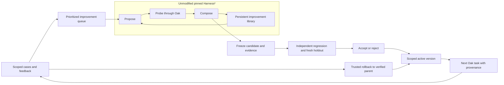

# Repeated Oak improvement with Harness²

This opt-in pipeline uses the actual Harness² method, pinned to
[`1cfe254e8d25b15f37048c3730134686abe60335`](https://github.com/google-research/harness2/tree/1cfe254e8d25b15f37048c3730134686abe60335).
The unmodified upstream core is vendored under `third_party/harness2`, with its
Apache-2.0 license and a verified file manifest. Oak supplies the benchmark,
subscription transport and independent deployment gate. The old
`oak.media_pilot` experiment driver does not orchestrate this pipeline.

The initial automatic scheduling recipe supports synthetic layered media
creation and repair. It is a working integration seam, with a deliberately
small task distribution. The earlier media pilots are public historical evidence
and regression material; their revealed holdouts are never fresh evidence again.
The independent two-cycle results belong in the accompanying execution report.
This guide describes behavior and reproduction, not a claim of measured gain.

For an installed Oak, the opt-in production bridge now connects actual task,
review, confirmed delivery and owner-reply metadata to this registry. The normal
gateway manages a bounded background worker; approved supported cases reach
the same genuine upstream search and independent gate without an operator
writing another experiment driver. `/improve status|stop|resume` exposes its
state and control in the authorized conversation. Configure it through
[`harness_improvement`](configuration.md#bounded-procedure-improvement).

This is deliberately scoped: raw conversations and private artifacts are not
automatically exported or approved. Metadata-only real cases await a supported
replay adapter and explicit source permission. The initial replay recipe is
synthetic layered media. Production monitoring therefore reports observations
without pretending that every real task has an independent quality verdict or
automatically triggering a quality rollback from an unverified failure.
Existing trusted rollback and accepted-only native follow-up remain separate.
An installed, running improvement system can correctly reject every candidate;
its deployment is not itself measured quality improvement.

Upstream reflection can legitimately return `NO_ENTRY`. Oak preserves those
verbatim DEV responses and unsuccessful attempt metadata in a separate scoped
`attempt_history`, with original SHA verification and a 16 KiB limit across the
last four completed cycles. This adapter addition was introduced before sealing
cycle 2. The selective upstream Library remains unchanged; independent grades,
acceptance decisions, regression and holdout inputs are excluded from history.



| Component | Direct upstream use | Oak adaptation or addition |
| --- | --- | --- |
| Search | `core.schedule.run_task`, sequential Propose–Probe–Compose, upstream proposal/composition prompts and validation | Default `k=1` recipe, a restricted instruction surface and native media benchmark |
| Evidence | Upstream context builders, trajectories, proposal contrasts and selection records | Allowlisted DEV sources, actual native tool traces and original/output image evidence; hidden properties and independent measurements excluded |
| Experience | Upstream `Library`, adopted harnesses and evidence-supported reflection | Library is private to one project, conversation and domain; Oak acceptance remains separate from upstream internal adoption |
| Model roles | Upstream `Proposer`/`Reply` contract and explicit proposer/selector injection | `SubscriptionRole` implements every role with existing ChatGPT authentication, `gpt-6.1-sol` and low effort |
| Tasks and execution | Actual upstream `BenchmarkAdapter` and `SurfaceSpec` protocols | Synthetic descriptors, existing Oak `Controller`/`PilotRuntime`, isolated local media tools, immutable receipts |
| Admission and operation | Upstream search state and cached artifacts remain intact | SQLite case registry, queue, budgets, freeze, fresh holdout tracking, independent acceptance, activation, monitoring records and rollback |

The audited upstream Codex executor is not used to launch these jobs. Its Codex
support does not authorize upstream proposer or selector channels: upstream
`ChannelSpec` accepts OpenCode and Claude channels. Oak explicitly implements
the structural role contract using `NativeRoleSpec(kind="oak_chatgpt_subscription")`
and passes its role object for both proposer and selector. No default upstream
API launcher, alternative model or API-key billing fallback is invoked.

Upstream's prompt templates recognize its Codex surface. Oak therefore uses
that surface's name and `AGENTS.md` instruction file, while restricting the
editable tree to that one file. Its contents become the reusable Oak procedure;
they do not install a new Codex environment. Other upstream components, such as
plugins, subagents and installed reusable scripts, are unavailable in this
initial adapter. Producers can still author local rendering code through the
existing isolated tool. Permissions, model, hidden answers, reviewer policy,
measurement thresholds and admission rules stay outside the editable surface.

## Setup and a complete bounded demonstration

Use Python 3.12 and the normal Oak dependencies, plus
`requirements-media-pilot.txt`. The local media environment needs Pillow,
NumPy, Bubblewrap, FFmpeg/FFprobe with H.264 support and DejaVu Sans fonts.
Keep a complete Codex distribution, including its matching code-mode host, on
`PATH`. Supply an already authorized ChatGPT runtime home directly. Do not copy
authentication or production account state into the checkout or experiment.

The examples below use explicit placeholder absolute paths. Replace them with
a writable private directory outside the checkout and the existing authorized
runtime home. Use the same root, project, chat and domain when resuming.

```sh
python3.12 -m venv .venv-media
.venv-media/bin/python -m pip install -r requirements.txt -r requirements-media-pilot.txt
.venv-media/bin/python -m oak.harness2_pipeline --root /absolute/private/oak-h2-run --project media-demo --chat 1 init-demo
.venv-media/bin/python -m oak.harness2_pipeline --root /absolute/private/oak-h2-run --project media-demo --chat 1 work --demo --max-cycles 2 --runtime-home /absolute/private/existing-codex-home
.venv-media/bin/python -m oak.harness2_pipeline --root /absolute/private/oak-h2-run --project media-demo --chat 1 status
```

`init-demo` imports the twelve published complex-pilot cases and prepares the
first cycle. `work --demo --max-cycles 2` creates at most two demonstration
cycles in that scope, across invocations. It resumes an unfinished cycle first;
rerunning it after both finish creates no third demonstration cycle. Fresh
artwork uses a persisted random namespace with deterministic descriptor
generation. Reproduction means rerunning the protocol and preserving its
committed inputs; a new root intentionally creates new artwork, not identical
stochastic model answers.

Each demonstration cycle has one new DEV task, two regression tasks and two
fresh holdouts. Cycle 1 develops on creation, then cycle 2 develops on repair
and reuses cycle 1's revealed holdouts as regression tasks. Both use the same
upstream domain library. One successful `k=1` search normally makes four
producer executions—base, two probes and composition—and four improvement-role
calls, including reflection. Independent comparison adds eight producer
executions, for twelve nominal producer slots per cycle. Reviews are additional
model calls inside producer execution and are reported separately.
At `k=1`, selection is trivial and makes no separate selector model call.

The sealed default caps allow sixteen producer reservations, eight improvement
role reservations and 512 improvement-tool calls per cycle, including retries.
Producer timeout is 600 seconds; improvement-role timeout is 300 seconds. Every
producer has the same existing 64-tool, 16-render and four-review limits.
One shared lock serializes top-level native roles and producers; waiting for
the lock does not consume a task's runtime timeout. Reviewer calls run within
the producer's bounded execution. Actual tool counts, review counts and elapsed
time are retained. Dollar cost is unknown for subscription execution; time and
tool calls are cost proxies, not invented monetary estimates.

## Cases, feedback and normal queue work

The registry is scoped by `(project_id, chat_id, domain)`. `case-add` stores a
structured case and groups recurring problems under an explicit signature.
Use `visibility: "public_fixture"` for generated public material or
`"explicit_private"` only for specifically authorized private material.
Recording a case alone does not authorize its artifacts for model contexts.
Only `--optimizer-approved` cases can schedule optimization.

The initial general scheduler consumes the highest-priority approved,
previously unused DEV descriptor in a pending queue group. It currently accepts
the `choreography` family. Generate a reproducible synthetic reproducer with the
provided descriptor API, rather than writing a new experiment driver:

```python
import json
from pathlib import Path
from oak.harness2_media import make_descriptor

case = {
    "visibility": "public_fixture",
    "descriptor": make_descriptor("approved-local-reproducer", 1, kind="repair"),
    "procedure_version": "current-scoped-version-id",
    "result": "reported_failure",
    "failure_reason": "Local foreground gaps incorrectly hide the moving artwork.",
}
Path("/absolute/private/case.json").write_text(json.dumps(case))
```

```sh
.venv-media/bin/python -m oak.harness2_pipeline --root /absolute/private/oak-h2-run --project media-demo --chat 1 case-add --json /absolute/private/case.json --signature source-preserving-depth --priority 100 --optimizer-approved
.venv-media/bin/python -m oak.harness2_pipeline --root /absolute/private/oak-h2-run --project media-demo --chat 1 work --max-cycles 1 --runtime-home /absolute/private/existing-codex-home
```

The same recipe generates new holdouts and independent comparisons. A reviewed
custom manifest can also be scheduled with `schedule --signature ... --manifest
/absolute/private/manifest.json`. Its `dev`, `regression` and `holdout` arrays
contain `{ "descriptor": ..., "commitment": ... }` entries produced by
`materialize_descriptor` and `source_commitment`. Construction controls run
before the manifest is sealed.

For an operator-reviewed custom search budget and task counts, `schedule` accepts
`--config /absolute/private/config.json`. This is a complete trusted configuration
file, prepared from `default_config()` using the current implementation:

```python
from pathlib import Path
from oak.harness2_pipeline import canonical, default_config

config = default_config()
config.update(k=2, max_producers=32, max_roles=12, max_role_tools=768)
config["policy"].update(regression_tasks=4, holdout_tasks=6)
Path("/absolute/private/config.json").write_text(canonical(config))
```

```sh
.venv-media/bin/python -m oak.harness2_pipeline --root /absolute/private/oak-h2-run --project media-demo --chat 1 schedule --signature source-preserving-depth --manifest /absolute/private/manifest.json --config /absolute/private/config.json
.venv-media/bin/python -m oak.harness2_pipeline --root /absolute/private/oak-h2-run --project media-demo --chat 1 work --max-cycles 1 --runtime-home /absolute/private/existing-codex-home
```

The manifest must match the declared task counts. The runner currently supports
one DEV task per cycle. At `k=2`, genuine upstream sequential search makes eight
nominal DEV producer executions and eight improvement-role calls, including an
anonymized selector between the two composed finals and reflection. Four
regression tasks and six fresh holdouts add twenty producer executions. The
example caps leave four producer and four role reservations for interrupted or
invalid attempts; per-attempt limits and admission checks remain the same.
Scheduling runs construction controls itself and binds their actual digest,
replacing any control digest supplied in the trusted file. Fixed subscription
model, effort, pin, finite budgets and input freshness remain enforced before
cycle or holdout reservation. The configuration and manifest are immutable once
scheduled. Existing scoped experience is retained when the same root and scope
are used; `work` resumes the scheduled cycle without the two-cycle `--demo` cap.

`feedback --case-id ID --json /absolute/private/correction.json` retains a user
correction and raises that problem group's queue priority. Feedback and native
outcomes remain linked to their case. Before the first native search call,
approved cases matching the current DEV descriptors and their corrections are
snapshotted once into bounded `OAK_CASE_EVIDENCE.json` in that cycle's optimizer
source context. Regression, holdout and independent measurements are excluded.
The snapshot stays immutable while a cycle runs; later corrections wait for a
subsequent cycle. Upstream's library separately carries earlier probe contrasts
and reflection. Production attachments are not
automatically transformed into synthetic task descriptors, copied into Git or
shared between users. Adding another media family or production ingestion needs
its own permission-aware materializer, construction controls and regression
recipe. These are explicit boundaries of the current automatic scheduler.

## Search, freeze and independent admission

`MediaBenchmarkAdapter` gives the upstream optimizer DEV tasks only. Its source
directory contains supplied artwork and a work description, without semantic
masks, measurement recipes, hidden answers or experiment state. Actual render
code, tool observations and visual-review reports form readable trajectories.
The producer sees its own complete public task contract in its isolated
workspace, while the independent runner regenerates semantic properties in
memory. Neither producer nor improvement role can read the grader or another
task's directory.

Before search, authored controls check task construction: valid source-based
outputs must pass the unchanged mechanical checks, while deliberate wrong-depth
or blurred-detail outputs must fail on content with valid format. Lossless PNG
construction frames and actual encoded video bytes are retained separately.
These local controls make no claim about native model quality or aesthetics.
An infrastructure-unverified control blocks native search; it is preserved
without relaxing measurement thresholds.

The inner Harness² search receives no independent mechanical scores. Its
internal adoption is a proposal for Oak, not deployment approval. Oak freezes
the chosen procedure, its parent, upstream result, source commitments, budgets,
implementation and admission policy before opening holdouts. Holdout identity
tracking uses actual source-image hashes, so relabeling an old task does not
make it independent. Once opened, a holdout can only be reused as development
or regression material.

The outer gate runs baseline and frozen candidate with identical model, effort,
tools, inputs and per-attempt budgets, rotating arm order. Its primary result is
joint success: completed native execution, unchanged sources, actual delivery,
an independent visual pass and an independent mechanical pass on the **same
immutable delivered SHA-256**. A high source-property score or a formula match
does not establish visual quality. Undelivered candidates remain failures even
if their pixels satisfy some properties.

Admission requires all planned comparisons, complete verified candidate
deliveries, no material visual defects, no invalid sources or conditions, no
lost baseline successes in regression, and strictly more joint successes on
fresh holdout. Ties and ceiling results retain baseline. Legitimate terminal
baseline failures remain in the denominator; they are not silently retried or
removed. Unknown infrastructure interruptions are distinct from quality
failures. Two unique holdouts per cycle support a narrow plumbing and transfer
demonstration; they cannot establish broad improvement across media work.

The articulated-mechanism family is excluded from this initial admission
scope. The earlier pilot exposed a tiny-marker sampling disagreement: legal
source geometry could fail its pixel check. Historical outcomes and caveats
remain intact. A future scorer repair needs authored alternative-convention
positives and semantic negatives before a fresh independent experiment.

## Durable state, stop and resume

The private root retains `pipeline.sqlite3`, `versions.sqlite3`, scoped input
seals, construction controls, the upstream library and per-cycle evidence.
Search output, freeze, evaluation and decision JSON are written once. Native
execution directories are opaque hashes of upstream logical run IDs; each has
`receipt.json`, immutable snapshots, actual tool traces and preserved attempt
directories. Improvement roles retain their own immutable completion receipts
and harness/response hashes.

Completed terminal executions, including refused, failed and unverified
deliveries, never execute again under the same identity. Observed source or
snapshot violations are durable completed negatives. A missing terminal receipt
is preserved as unknown; only that unfinished execution can resume in a fresh
workspace, within the original total budget. An interruption before the producer
starts is recorded separately. Postcompletion evidence tampering fails closed
and never triggers an automatic replacement run.

```sh
.venv-media/bin/python -m oak.harness2_pipeline --root /absolute/private/oak-h2-run --project media-demo --chat 1 stop
.venv-media/bin/python -m oak.harness2_pipeline --root /absolute/private/oak-h2-run --project media-demo --chat 1 resume
.venv-media/bin/python -m oak.harness2_pipeline --root /absolute/private/oak-h2-run --project media-demo --chat 1 work --max-cycles 1 --runtime-home /absolute/private/existing-codex-home
```

Stop prevents new reservations and improvement-tool calls. An already running
producer remains bounded by its timeout; stop does not blindly kill or replay
uncertain actions. An exclusive worker lock prevents duplicate workers. On
restart the raw terminal caches determine whether native execution finished;
unreconciled budget intents remain visible separately. Budgets and implementation
cannot be enlarged or rewritten inside a sealed cycle. A changed implementation
requires a new cycle, preserving old evidence.

## Closing an unmeasured infrastructure cycle

A search that returns no chosen harness now ends without constructing a
candidate or opening its holdouts. Its journal uses terminal `phase="completed"`
with `outcome="not_admitted"`, `classification="search_no_candidate"`,
`accepted=false`, `evaluated=false` and `quality_rejection=false`. This is an
unmeasured outcome, not a baseline/candidate quality comparison.

An operator can explicitly retire a stuck cycle from an older implementation:

```sh
.venv-media/bin/python -m oak.harness2_pipeline --root /absolute/private/oak-h2-run --project media-demo --chat 1 --domain media-depth close-pre-freeze --cycle CYCLE_ID --reason-code review_transport_configuration_error --authorization-reference AUTHORIZATION_SHA256
```

Replace `AUTHORIZATION_SHA256` with a 64-character lowercase SHA-256 commitment
to the explicit authorization, retained privately. The other declared reason
is `implementation_changed_before_freeze`. This command acquires the worker
lock and refuses a frozen candidate or any opened holdout. It performs no model
call and creates no candidate or activation. Its immutable `termination.json`
commits the original configuration, manifest, search and original file bytes;
it records `classification="infrastructure_abort"` without rewriting those
inputs or native receipts. Repeating the same closure verifies its commitments;
changed evidence or authorization fails closed.

The closed cycle still consumes its original cycle quota. A replacement needs
separate finite authorization and a supported approved DEV case or new approved
feedback revision. It seals the current implementation and new holdouts. Old
unopened holdouts remain reserved and are excluded from the replacement's
regression history. Authentic, SHA-verified earlier DEV role observations can
still appear in attempt history; closure creates no optimizer lesson.

Public export retains its public-fixture permission checks. For a verified
unmeasured closure it publishes unopened-holdout counts and termination hashes,
omits unopened descriptors, seeds, source paths and images, and excludes the
cycle from quality denominators. Normal measured cycles retain all original
freeze and evaluation checks. No quality gain is inferred from recovery.

## Applying accepted procedures and reverting

`HarnessVersions` stores immutable parents, procedure hashes, evidence and
accept/reject decisions. Only an accepted version can replace its current
parent. Bootstrap records describe the existing Controller procedure; they do
not assert comparative superiority. An `oak_experience` lesson marked `proven`
still means its artifact passed review, not that the procedure won an
independent comparison.

Opt-in Controller configuration identifies the trusted deployment store and
applicable domain:

```json
{
  "harness_activation": {
    "store_path": "/absolute/private/oak-h2-run/versions.sqlite3",
    "project_id": "media-demo",
    "domain": "media-depth"
  }
}
```

Every task resolves the active version for its actual conversation, including
resumed threads. It persists an application intent with version ID, procedure
SHA, context SHA and input SHA, then binds the actual native turn ID. There is
no automatic domain classifier: callers configure the appropriate scope.
The producer cannot activate or accept its own advice through experience tools.

Trusted rollback uses `HarnessVersions.rollback(project, chat, domain,
expected_active=..., reason=...)`; it restores a previously active accepted
ancestor, records the event and quarantines the regressed version. Acceptance
and application history survive reopening the store. Reacceptance requires a
new candidate and independent decision.

Each controlled follow-up also records scoped delivery, review, source-integrity,
time, tool and artifact-reference metadata in the registry. A failed follow-up
raises its queue priority. These monitoring cases remain optimizer-unapproved;
they contain no raw prompts, hidden measurements or reusable DEV descriptor.
A new development case still needs explicit source permission.

After a real independently accepted cycle, a learned-procedure follow-up can
verify the actual Controller input path without an administrative fixture:

```sh
.venv-media/bin/python -m oak.harness2_followup --root /absolute/private/oak-h2-run --project media-demo --chat 1 --domain media-depth --cycle-id ACCEPTED_CYCLE_ID --runtime-home /absolute/private/existing-codex-home
```

It requires the cycle's admitted candidate to be active and binds the independent
decision, procedure, application context, input and actual native turn. It runs
one new synthetic task with a separate cap of two producer attempts, retaining
unknown intents and never replaying terminal results. The follow-up source is
reserved as exposed, so it cannot become a later fresh holdout. Independent
visual and mechanical checks use the same delivered SHA. A conclusive, verified
terminal quality failure restores the accepted parent; unknown infrastructure
evidence cannot trigger that quality rollback. Monitoring remains scoped and
optimizer-unapproved. Follow-up success is an application/monitoring check, not
another comparative quality win. This isolated media runner currently supports
conversation 1 only; the command rejects another conversation rather than
substituting its scope. Production Controller activation remains configurable
for its actual conversation.

The separate controlled activation demonstration temporarily activates explicitly
labeled benign advice, blocks a deliberately rejected candidate, executes a
native follow-up, reopens the store, rolls back and executes another follow-up:

```sh
.venv-media/bin/python -m oak.harness2_activation_demo --root /absolute/private/oak-h2-run --project media-demo --runtime-home /absolute/private/existing-codex-home
```

Its administrative accept/reject fixtures test deployment plumbing, not learned
quality. Native application provenance is distinct from its controlled decision
records and from the two independent improvement cycles. It restores the
original scoped pointer; it does not deploy to a production Oak instance.

Focused standard-library checks are reproducible with:

```sh
PYTHONPATH=tests .venv-media/bin/python -m unittest test_harness2_upstream test_harness2_media test_harness2_pipeline test_harness2_pipeline_history test_harness2_report test_harness_versions test_harness_activation test_harness2_activation_demo test_harness2_followup test_harness_rollback_quarantine test_harness_controller_scope test_media_pilot_runtime test_state
```

Keep three evidence classes separate in reports: local tests and authored codec
controls; actual subscription-backed Oak executions and reviews; and live
external-provider checks. This pipeline demonstrates the first two. It does
not verify YouTube, Telegram delivery or other external media providers.
