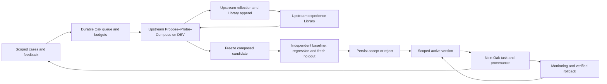

# Harness² integration in Oak

Oak uses the actual [Harness² source](https://github.com/google-research/harness2/tree/1cfe254e8d25b15f37048c3730134686abe60335),
commit `1cfe254e8d25b15f37048c3730134686abe60335`, package version **0.1.0**.
The method core is vendored unchanged under [`third_party/harness2`](../third_party/harness2/README.md),
with its Apache-2.0 license and a per-file SHA-256 manifest. The loader verifies
the pinned manifest, every included source file, and the imported package's
location. It rejects another installed `harness2` package. No upstream method
source patches are applied. This release requires Python 3.12 or 3.13.

The earlier media pilots supplied task constructors, isolation, source-property
checks and evidence. Their custom search loop is not the engine of this
integration, and their negative findings are retained. Those pilots did not
establish a general improvement in Oak.

## Components



| Capability | Actual implementation | Ownership |
| --- | --- | --- |
| Reference execution, INV and DOM proposals, native probes, composition and final execution | `harness2.core.schedule.run_task`, `core.recursion.run_sequential` | Unmodified upstream |
| Context construction and grader-leak tripwires | `core.context.build`, `copy_source`, verdict-marker checks | Unmodified upstream; Oak supplies allowlisted evidence |
| Component materialization, validation, retries and fallback | `core.tree`, `core.recursion._run_stage`, `adapter.validate_tree` | Upstream method plus Oak surface invariants |
| Internal final adoption | `core.selection.trivial_selection` at `k=1`; `run_selection` for larger pools | Unmodified upstream |
| Cross-task experience | `core.selection.reflect_adoption`, `core.library.Library` | Unmodified upstream |
| Method summaries and completed-task resume | `core.schedule._write_summary`, `_resume` | Unmodified upstream plus Oak artifact-integrity checks |
| Native media execution and observation | `oak.harness2_media.MediaBenchmarkAdapter`, existing `PilotRuntime`/Controller | Oak adapter |
| Model transport for INV, DOM, composition, selection and reflection | `oak.harness2_upstream.SubscriptionRole` | Explicit Oak subscription adapter |
| Task/material registry, feedback, deduplicated queue, sealed policy and fresh-example reservations | `oak.harness2_pipeline.PipelineStore` | Added Oak operational state |
| Independent comparative acceptance | Oak pipeline plus `harness2_media.evaluate_delivery` | Added outer gate, separate from internal search |
| Version lineage, immutable decisions, active pointer, application provenance and rollback | `oak.harness_versions.HarnessVersions`, Controller integration | Added Oak deployment state |

## What the upstream method does

`run_development` calls the genuine upstream `schedule.run_task` with one
sequential mode and an explicit persistent `Library`. At `k=1`, upstream runs
one reference producer, proposes one invariant and one domain candidate,
executes both, composes their behavioral contrasts, then executes that final.
The method ledger checks **four producer executions and three improvement
stages**. Reflection is an additional role call outside that ledger. Invalid
proposals and transport failures can cause additional attempts; Oak's durable
invocation budgets count initiated attempts rather than relying on that nominal
ledger identity.

The bounded Oak worker supplies the same native lock file to its media executor
and every improvement role. Upstream still constructs its parallel INV/DOM
phases; actual native model jobs are serialized for comparable host resources.
The lock changes execution concurrency, not the upstream search stages or the
evidence available to them.

Upstream's final pool excludes the baseline. With one final it adopts that
delivered final without a selector session; with more finals it can use an
anonymized selector. **That internal adoption is not an Oak activation or a
claim of superiority.** Oak freezes the candidate and performs its independent
comparisons afterward. A composition may be retained in upstream search
experience while the outer gate rejects its activation.

Upstream reflection sees native execution observations, the original work,
candidate trees and edit decisions, including unsuccessful edits. It returns
evidence-supported `cue`, `lesson` and `evidence` fields, or no entry. The
library stores those fields with the full adopted tree. Future Propose and
Compose sessions read earlier same-domain entries. This is the harnessing-level
recursion implemented in this pinned release; it does not rewrite the Python
source of upstream's own prompts.

The real first native reflection returned `NO_ENTRY`, leaving upstream Library
empty. Before cycle 2, Oak added a separately labelled `attempt_history` to the
DEV context. It retains verbatim role responses and failed-attempt metadata
from up to four completed earlier cycles in the same scope, bounded to 16 KiB
and verified against original native receipts. This preserves negative
observations without inventing a Library entry. No independent grades,
acceptance decisions, regression or holdout material enter that history.
The report distinguishes actual Library entries from this adapter addition and
records the exact context copies and file-read requests. A read request alone
does not prove model comprehension. Upstream search and reflection are unchanged.

The adapter calls `run_task` directly. Upstream's `run_domain` prunes its library
to the prefix of the supplied task stream, so invoking a new sweep with only
the next cycle's new task would erase the previous cycle's entries. Oak keeps
the existing library and supplies each new queued DEV case to `run_task`.
Library roots must remain scoped to the selected project and conversation.

## Subscription authentication and the editable surface

All model-backed roles use the existing Oak `RuntimeClient`, the existing
authorized ChatGPT account, **`gpt-6.1-sol` with low effort**, and no model or
provider fallback. No new account state is copied. The runtime checks ChatGPT
authentication before executing a thread.

The upstream `CodexSubstrate` is a different executor path: its preflight
requires a Responses endpoint and API key. Its presence does not authenticate
the improver, selector or reflection roles. Upstream `Proposer` supports
OpenCode and Claude CLI channels; neither is silently selected here. Oak passes
its explicit `SubscriptionRole` for both proposer and selector parameters, so
upstream never constructs another provider client. `NativeRoleSpec` records the
actual channel as `oak_chatgpt_subscription` rather than claiming OpenCode or
Claude execution. No Vertex setup, LiteLLM bridge, API billing or separate
upstream Codex distribution is used.

The upstream prompt factory recognizes `codex` and `opencode` surfaces. This
adapter uses the Codex instruction schema restricted to **`AGENTS.md`**, and
maps that file's text into Oak's scoped working procedure. Only that file is
harvested and applied. Scripts, skills, hooks, plugins and delegation described
by the broader upstream prompt are explicitly unavailable and rejected by this
first adapter. Adding another component requires both a real isolated Oak
implementation and new validation; it cannot be enabled by candidate prose.

Role sessions expose only confined context list/read/image-view tools and a
write tool for the declared harness file. Shell, arbitrary file access, apps,
MCP servers, network tools, native image generation, memory and delegation are
disabled. The task executor retains the existing media sandbox, permitted
libraries and independent reviewer. The improvement role never receives the
grader implementation, hidden semantic masks or unrevealed holdout material.

## Persistence, measurements and limits

`SubscriptionRole.call` implements upstream's real `Reply`/harvest contract.
Its cache identity includes the pinned upstream commit, bridge source SHA,
model/effort, mission/system/context SHA values, editable surface and budgets.
Completed responses and harvested trees are rehashed before reuse. A restart
does not rerun a verified completed role. Interrupted attempts retain their
original workspaces and receipts, and use a new persisted attempt ordinal.
The worker reserves the outer budget before each uncached model attempt and
each context tool operation. A crash during completion-index publication is
recovered from the completed receipt.

`run_development` returns the genuine upstream `TaskResult` unchanged, with an
additional `oak_provenance` attribute containing the chosen harness path, pinned
commit, library SHA values and entries before/after, and role audit paths.
Those private audit files contain per-attempt status, cache identity, model,
tool operations, elapsed time, response SHA and harvested-tree SHA. Public
reports should export selected hashes and counts rather than private context
trees or local account paths.

Visual quality and mechanical properties are separate measurements. Delivery
success requires that the actual immutable delivered artifact has the same SHA
as the artifact that passed independent visual review and the property checks.
A high deterministic score alone does not establish acceptable visual quality.
Incomplete native executions, absent deliveries and infrastructure interruptions
must remain visible against the planned comparison counts. Exposed holdout
examples can become regression material; subsequent improvement claims require
fresh independent examples.

Upstream `Reply.cost_usd=0.0` is a compatibility accounting value for the
subscription adapter, **not a measurement of zero monetary cost or a claim that
execution is free**. Native receipts explicitly record USD as unavailable.
Reports use model invocation counts, tool calls and elapsed time as cost
proxies; token counts are retained where the native transport reports them.

## Verification boundaries

Run focused local checks from the repository with its Python environment:

```bash
python -m unittest tests.test_harness2_upstream -v
```

These checks execute the genuine pinned method across two sequential tasks,
verify reflective library reuse and restart behavior, and exercise the confined
subscription adapter with a mocked native transport. They make no model calls.
The upstream source checkout's original five deterministic workflow tests also
passed independently. Neither set proves model-backed candidate quality or
access to a live media provider.

The full pipeline's two-cycle report must separately identify native Oak model
executions, independent heldout results, accepted/rejected decisions, activation
provenance, restart and rollback evidence. No external provider test follows
from local media generation, a mocked site, Chromium fixtures or these method
tests. Model-backed outcome reports must state directly when no quality gain
was established.

After the selected cycles finish, export their public synthetic evidence with:

```bash
python -m oak.harness2_report --root /absolute/private/pipeline \
  --project harness2-demo --chat 1 --output /absolute/output/two-cycle-results.json
```

The exporter opens the journals read-only, refuses any non-public case in the
selected scope and refuses pending cycles so unopened holdouts remain private.
It rehashes bound artifacts, source files, role responses and harvested trees;
retains interrupted and failed attempts; exports full terminal review and
mechanical receipts; and reports per-arm denominators and cost proxies. Paths
become portable placeholders. Original receipt SHA values commit the local
bytes before substitution, while a separate content SHA commits the portable
report. A completed controlled activation report and its followup receipts are
included when present in the same selected scope.
